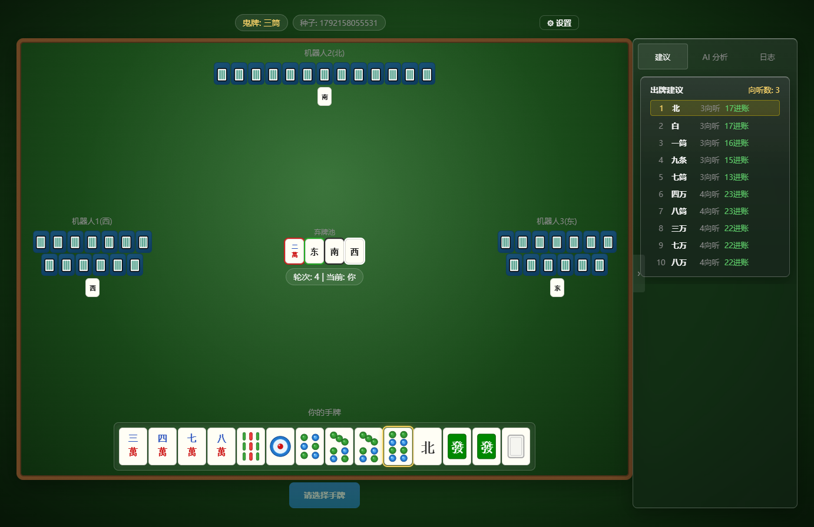
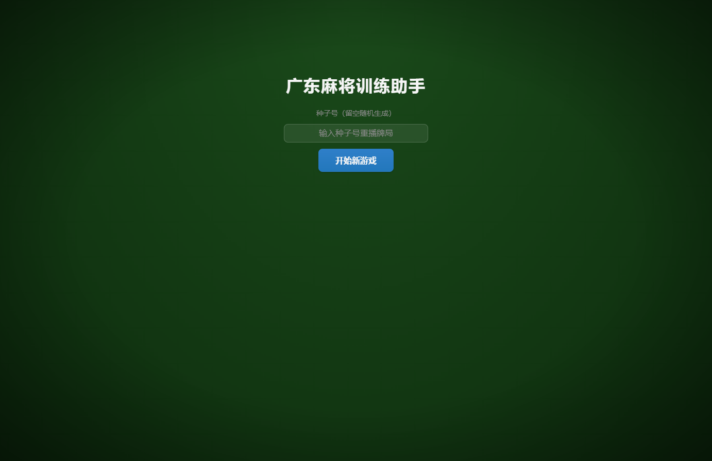
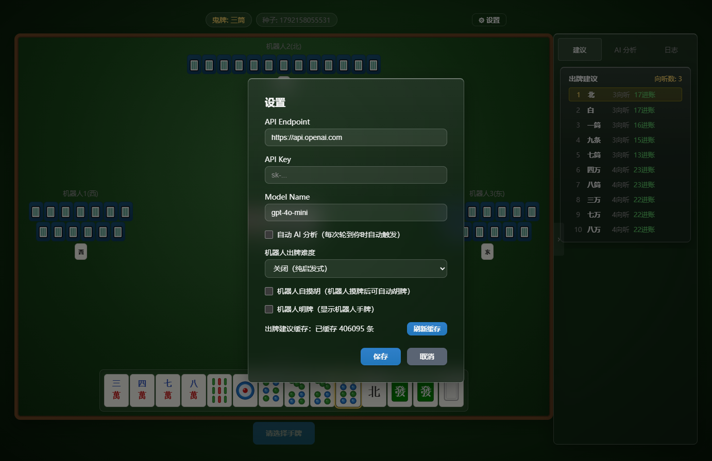
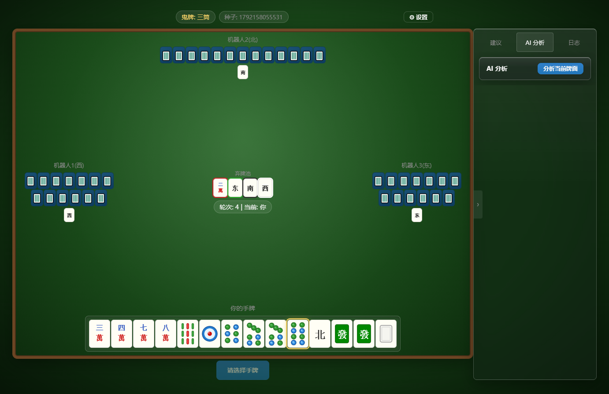
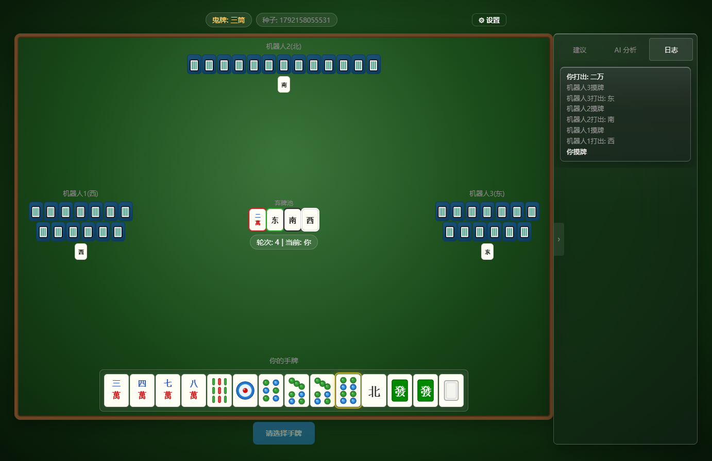

# 广东麻将训练助手

一款面向广东麻将「推倒胡」玩法的练习工具。浏览器中即可运行，也可打包为 Android 应用。无需服务端即可开始对局；AI 分析为可选功能，需要自行配置兼容的 AI 服务。



> 以下界面图均截自当前版本在本地浏览器中的实际运行画面，使用固定种子 `1792158055531`。

## 功能

- **四人对局**：玩家与三名机器人进行单局练习。支持摸牌、出牌、碰牌，以及明杠、暗杠和加杠；机器人会自动进行后续回合。
- **广东推倒胡规则**：不能吃牌，只能自摸胡牌；支持标准牌型、七对和十三幺，并有随机鬼牌（万能牌）。对局结束后可查看结算、各家手牌及剩余牌墙。
- **出牌与应对建议**：显示向听数、进张效率和候选出牌；遇到可碰、可杠的牌时也会给出反应建议。重计算在 Web Worker 中执行。
- **AI 牌局分析**：可配置 API Endpoint、API Key 和模型名称，手动分析当前牌局，或开启自动分析。
- **机器人难度**：关闭、低、中、高、最高共五档，在启发式策略与算法建议之间调整机器人出牌强度；也可单独控制机器人是否自摸胡牌、是否明牌。
- **种子复盘**：开局时输入种子可重播相同牌序；种子会显示在牌桌与结算中，便于分享和复盘。
- **矢量牌面**：麻将牌以 SVG 绘制，放大时仍保持清晰。

## 界面截图

### 开局与牌桌

输入种子可以重播牌局；留空则随机生成。牌局中会显示鬼牌、种子、弃牌池、手牌与本地出牌建议。

| 输入种子开始新局 | 实际牌局与出牌建议 |
| --- | --- |
|  |  |

### 设置、AI 分析与日志

设置面板可配置 AI 服务、自动分析和机器人行为。右侧信息面板包含本地建议、AI 分析入口与本局日志；调用 AI 需要先配置可用的服务端点和密钥。

| 机器人与 AI 设置 | AI 分析入口 | 牌局日志 |
| --- | --- | --- |
|  |  |  |

### SVG 牌面

牌面由项目组件实时绘制为 SVG，下面展示当前版本使用的牌面样式：

| 万 | 条 | 筒 | 风 | 箭 |
| --- | --- | --- | --- | --- |
|  |  |  |  |  |

## 快速开始

需要 Node.js 18 或更高版本。

```bash
git clone https://github.com/Bertramoon/Guangdong-Mahjong-Training-Assistant.git
cd Guangdong-Mahjong-Training-Assistant
npm install
npm run dev
```

在浏览器中打开 Vite 输出的本地地址，通常是 `http://localhost:5173`。首次运行会在浏览器后台生成牌效计算缓存，并保存到 IndexedDB；之后访问同一浏览器时会复用缓存。当前版本缓存 406,095 条花色计算结果。

构建与预览：

```bash
npm run build
npm run preview
```

运行单元测试：

```bash
npm test
```

## AI 分析配置

进入牌局后打开「设置」，填写服务商提供的 API Endpoint、API Key 和模型名称。配置保存在当前浏览器本地。

启用 AI 分析时，当前牌局的手牌及牌局上下文会发送到你配置的 AI 服务进行分析。请只填写你信任的服务端点；不配置 AI 也可以进行完整对局并使用本地算法建议。

## Android

项目使用 Capacitor 将 Vue 应用打包为 Android 应用。构建和安装需要 Android Studio、Android SDK 及已配置的设备或模拟器：

```bash
npm run android:build
npm run android:install
```

开发时可通过局域网地址连接设备：

```bash
npm run android:dev
```

## 技术栈

- Vue 3、TypeScript、Vite
- Capacitor 8（Android）
- SVG 牌面与 Web Worker
- IndexedDB：持久化向听数计算缓存
- 浏览器本地存储：保存 AI 配置和游戏设置

## 当前范围

- 每次启动为单局对战；目前不保存历史牌局，也没有历史统计或累计积分榜。
- AI 分析是可选项，AI 服务的可用性、费用与数据处理方式取决于用户配置的服务商。
